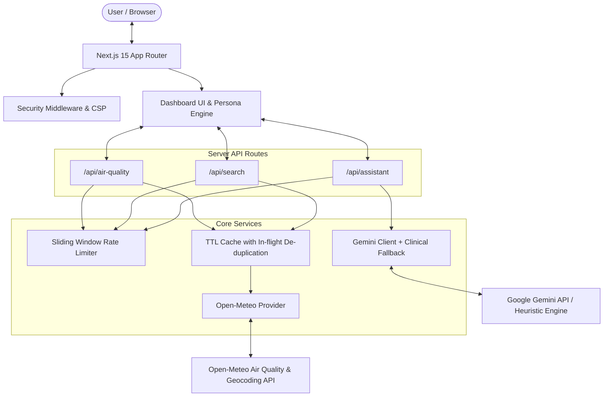

# 🍃 Urban Air — Environmental Health & AQI Defense Assistant

> **Science-backed air quality monitoring, personal exposure simulation, and actionable health guidance calibrated for real-world vulnerability.**

[](https://nextjs.org/)
[](https://react.dev/)
[](https://www.typescriptlang.org/)
[](https://vitest.dev/)
[](https://playwright.dev/)
[](#accessibility-first-design)
[](https://www.docker.com/)

---

## 📖 Overview

Most air quality apps stop at displaying an abstract, color-coded number. **Urban Air** bridges the gap between atmospheric science and personal health decision-making. 

It translates real-time EPA AQI data into actionable, persona-calibrated safeguards for high-risk demographics: parents protecting developing lungs, households managing elderly cardiovascular health, outdoor laborers enduring 8+ hour shifts, and community organisers mobilizing neighborhood defenses.

### Core Principles
1. **Data Honesty & Transparency**: Snapshots carry data provenance flags (`modelled` CAMS vs `measured` station data). If reported provider values differ from calculated particulate indices by $>10$ points, discrepancies are transparently flagged rather than obscured. No synthetic placeholder values are ever substituted.
2. **Actionable Health Interventions**: Numerical readings are tied directly to quantitative risk mitigation: HEPA Clean Air Delivery Rate (CADR) sizing, ventilation timing, respirator filtration efficiencies, and Berkeley Earth inhaled-dose calculations.
3. **Accessibility First (WCAG 2.1 AA)**: Health warnings never rely on color alone. Every threshold includes distinct non-color unicode symbols (`✓`, `•`, `▲`, `⚠`, `⛔`, `☠`), minimum contrast ratios ($\ge 4.5:1$), semantic ARIA markup, and full keyboard navigability.
4. **Resilient AI & Offline Fallback**: Features an integrated Gemini assistant that can run with a server environment key, a user-supplied frontend key, or a fully offline clinical heuristic rules engine.

---

## 🎯 Target Personas

Urban Air dynamically tailors advice, thresholds, and action recommendations across 4 distinct profiles:

| Persona | Priority Pollutants | Vulnerability & Health Rationale |
| :--- | :--- | :--- |
| **Parent of Young Children** | $\text{PM}_{2.5}$ & $\text{O}_3$ | Young lungs have higher respiratory rates per pound of body weight. Strollers sit at exhaust tailpipe height ($<1\text{m}$), amplifying particulate deposition. |
| **Elderly-Care Household** | $\text{PM}_{2.5}$ & $\text{NO}_2$ | Systemic vascular inflammation increases stroke, myocardial infarction, and COPD exacerbation risks during temperature inversions. |
| **Outdoor Worker / Commuter** | $\text{PM}_{2.5}$, $\text{PM}_{10}$ & $\text{CO}$ | Continuous 8+ hour physical exertion multiplies inhaled alveolar toxic dose $3\times$ to $5\times$. Focuses on tight N95/FFP2 respirator seals and vehicle cabin air recirculation. |
| **Community Organiser** | All Public Health AQI | Coordinates collective defense: indoor school recess policies, mutual aid clean-air shelters, street-vendor mask distribution, and noticeboard alerts. |

---

## 🚀 Key Features

### 1. Real-Time Dashboard & Geolocation
- **US EPA AQI Calculation**: Recomputes $\text{PM}_{2.5}$ and $\text{PM}_{10}$ sub-indices using the revised EPA breakpoints and reports full pollutant details ($\text{PM}_{2.5}$, $\text{PM}_{10}$, $\text{NO}_2$, $\text{O}_3$, $\text{SO}_2$, $\text{CO}$) in $\mu\text{g/m}^3$.
- **Browser Geolocation**: One-click "📍 Use My Location" fetches device coordinates with high accuracy and clear permission/timeout handling.
- **Debounced Location Search**: Search any city, district, or region worldwide via Open-Meteo geocoding.

### 2. Routine Planner & 18-Hour Safe Windows
- Evaluates next-18-hour hourly forecasts to recommend the safest time window for specific activities:
  - 🏃 *Jogging & Cardio*
  - 🎒 *School Walk / Drop-off*
  - 🐕 *Dog Walking*
  - 🔨 *Outdoor Work Shift*
  - 🛒 *Evening Errands*
- Assigns ratings (*Optimal*, *Acceptable*, *Risky*, *Avoid*) across an interactive timeline.

### 3. Indoor Air Engineering & HEPA CADR Guide
- **CADR Calculator**: Computes required Clean Air Delivery Rate (Smoke CFM and $\text{m}^3/\text{h}$) to achieve the gold standard 5 Air Changes per Hour (ACH) based on room square footage and ceiling height.
- **Natural Ventilation Advisor**: Dynamically signals whether outdoor air is clean enough for whole-house flushing or if windows should remain sealed.
- **Household Hazard Checklist**: Range hood exhaust protocols, avoiding indoor combustion (incense/candles), and damp-dusting practices.

### 4. Health Impact & Inhaled Dose Simulator
- Simulates daily inhaled $\text{PM}_{2.5}$ intake ($\mu\text{g/day}$) using human tidal breathing volumes based on:
  - Hours spent outdoors ($0$ to $16\text{h}$)
  - Mask type (None, Cloth, Surgical, or Certified N95/FFP2)
  - Home HEPA air filtration
- Compares intake against the Berkeley Earth cigarette particle equivalent ($\sim 22\,\mu\text{g/m}^3$ over 24h $\approx 1$ cigarette equivalent) with clear epidemiological context.

### 5. Community Mode & Advisory Flyer Generator
- Generates formatted, ready-to-print or copy-paste public health advisories for neighborhood WhatsApp groups, schools, resident associations, and noticeboards.
- Vulnerable neighbor welfare check protocol and school recess safety guidelines.

### 6. Gemini Environmental Health Assistant
- Server-side route (`/api/assistant`) with prompt engineering tailored to the active persona and current air conditions.
- **Frontend Key Configuration**: Users can input their own Google Gemini API key directly in the UI; keys are saved in browser `localStorage` and never logged.
- **Clinical Heuristic Fallback**: If no key is set or network connectivity drops, an offline expert rules engine automatically steps in to provide clinical guidance.

### 7. Security & Defense-in-Depth
- **Sliding-Window Rate Limiter**: Enforces tiered request limits across endpoints with standard headers (`X-RateLimit-Limit`, `X-RateLimit-Remaining`, `X-RateLimit-Reset`, `Retry-After`, HTTP 429).
- **Strict Content Security Policy (CSP)**: Hardened headers prohibiting unauthorized script injection, framing (`frame-ancestors 'none'`), and restricting connect origins.

---

## 🛠️ Architecture & Tech Stack



- **Framework**: Next.js 15.1 (App Router), React 19
- **Language**: TypeScript 5.7 (strict mode)
- **Validation**: Zod 3.24
- **Testing**: Vitest 2.1, Playwright 1.65, Axe-core (WCAG 2.1 AA)
- **Containerization**: Multi-stage Docker build with Alpine Linux

---

## 🏁 Getting Started

### Prerequisites
- Node.js 20+ or 22+
- npm 10+ (or Docker)

### Installation

1. **Clone the repository**:
   ```bash
   git clone https://github.com/your-username/urban-air.git
   cd urban-air
   ```

2. **Install dependencies**:
   ```bash
   npm install
   ```

3. **Configure Environment (Optional)**:
   Copy `.env.example` to `.env.local`:
   ```bash
   cp .env.example .env.local
   ```
   Add your Google Gemini API key if you wish to configure it server-side:
   ```env
   GEMINI_API_KEY=your-gemini-api-key-here
   ```
   *(Note: You can also leave this blank and supply a key directly in the web UI, or rely on the built-in clinical engine.)*

4. **Run Development Server**:
   ```bash
   npm run dev
   ```
   Open [http://localhost:3000](http://localhost:3000) in your browser.

---

## 🧪 Testing

Urban Air maintains a thorough test suite covering mathematical calculations, rate limiting, provider resilience, end-to-end flows, and accessibility.

```bash
# Run unit & integration tests (Vitest)
npm test

# Run TypeScript compilation check
npm run typecheck

# Run end-to-end & accessibility audits (Playwright)
npm run test:e2e

# Run all test suites together
npm run test:all
```

### Accessibility Audit Results
Playwright runs `@axe-core/playwright` across the dashboard:
- **0 Critical Violations**
- **0 Serious Violations**
- Meets WCAG 2.1 Level AA color contrast ($\ge 4.5:1$) and non-color cue requirements.

---

## 🐳 Docker Deployment

A production-ready multi-stage Dockerfile is included, optimized for Next.js standalone output:

### Using Docker Compose
```bash
# Build and run the container
docker compose up --build

# Run in background
docker compose up -d
```
The application will be live at [http://localhost:3000](http://localhost:3000) with automatic container healthchecks.

### Manual Docker Build
```bash
docker build -t urban-air:latest .
docker run -p 3000:3000 --env GEMINI_API_KEY=your_key urban-air:latest
```

---

## 🔒 Security & Privacy

- **Zero Third-Party Trackers**: No analytics or external tracking scripts.
- **Client-Side Key Storage**: Custom user API keys are stored solely in the user's browser `localStorage` and sent over HTTPS only when invoking the assistant route.
- **Rate Limiting**: Sliding window rate limiter prevents API abuse on server routes.
- **Content Security Policy**:
  ```http
  default-src 'self'; script-src 'self' 'unsafe-eval' 'unsafe-inline'; frame-ancestors 'none';
  ```

---

## 📄 License

This project is licensed under the [MIT License](LICENSE).
